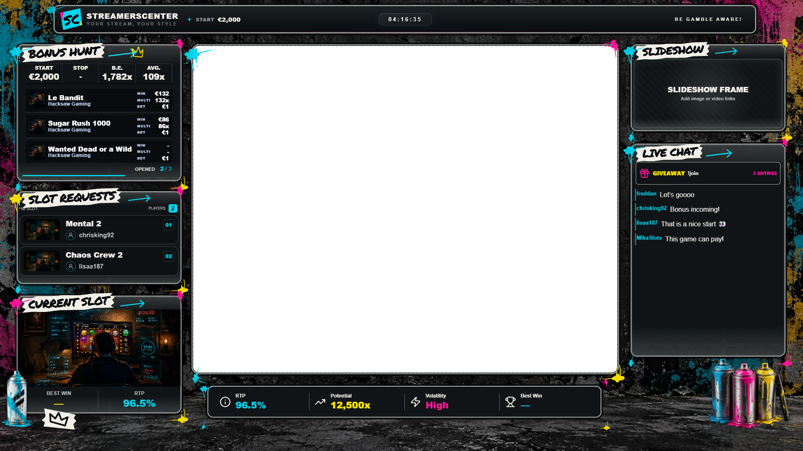

# Street Art theme — implementation and verification

## Frame and chat update

Select **Background → Street Art materials → Reference gameplay frame** to edit **Main frame left, top, width, height, corners and thickness**. Dimensions use the 1920×1080 design canvas. The background instance saves `streetArt.gameplay`; the shared environment renderer uses the same rectangle and radius for the border and transparent scenery cutout. Older layouts retain the original defaults. Applying the explicit reference preset restores reference dimensions.

Street Art shoutouts retain their configured chat position and media height, contained video artwork and a visible absent-clip fallback. The local card treatment keeps long streamer names and channel links within the panel. Giveaways still reuse the existing entry, drawing and winner renderers above messages; an active shoutout temporarily uses that bay and the giveaway returns after it ends.

The updated `scripts/test-street-art-theme.mjs` checks resized frame controls, JSON layout round trips, the actual published OBS renderer, cutout alpha, clip playback, missing clips and giveaway states. Production build, widget validation and control-category checks pass. Native OBS was not launched. No database migrations or dependencies were added.

Implemented in the existing React/Vite overlay system on 2026-10-18. No new application, service, subscription, dependency or database migration was introduced.

## Delivered

- Street Art is selectable in the existing theme gallery. Shared palette tokens and the editor/OBS widget registry apply the materials to the supported widget families.
- The explicit **Street Art reference layout** action builds the 1920×1080 composition. Selecting only the colour theme preserves existing widget geometry. The preset preserves data, instance IDs, locked non-background widgets and duplicate instances, and only creates missing required widget types. An existing unlocked gameplay capture widget is fitted to the opening without changing its source configuration.
- Distressed metal surfaces, torn-paper brush headings, cyan/magenta/yellow paint, small drips, arrows, crowns and lower-edge stickers remain separate rendered layers.
- Realistic transparent spray-can assets attach to Current Slot and chat. The chat props sit outside the message area. Background, splashes and props have independent instance settings.
- The reference hunt reuses canonical session calculations, thumbnail resolution, list ordering, list scrolling and opened progress. The separate request widget keeps its existing queue and automatic scrolling.
- A wide Current Slot cover variant uses the existing metadata and personal-best hook. Missing values remain dashes; numeric zero remains valid. Artwork fallback, cover visibility and statistic visibility are retained.
- The reference RTP strip uses the existing active-slot and best-record resolution. The four cells expose only their supported appearance elements.
- Chat preserves live message processing and giveaway visibility rules. Active giveaway notices, roulette and winner cards remain inside the same chat panel above messages; unused giveaway space is reclaimed.
- Slideshow media handling is unchanged. Image and video playback were checked through the actual component.
- Materials controls cover paint colours, texture strength, frame thickness, supported panel opacity, sticker/content fonts and visibility. Existing scoped V2 overrides remain supported. Reference hunt and RTP variants declare separate strict appearance schemas.
- The theme is static. Shared raster assets total approximately 1.06 MB, and no additional effects canvas is allocated. Gameplay cutout alpha was checked directly in a screenshot.

## Files created

- `src/effects/ThemeEffects/street-art/streetArtTheme.js`
- `src/effects/ThemeEffects/street-art/StreetArtTheme.jsx`
- `src/effects/ThemeEffects/street-art/StreetArtTheme.css`
- `src/components/OverlayCenter/editor/streetArtComposition.js`
- `public/theme-effects/street-art/`: optimized concrete and transparent prop assets, shared grain SVG and provenance notes.
- `public/fonts/street-art/`: Permanent Marker font and its Apache 2.0 license.
- `scripts/test-street-art-theme.mjs`
- This report and `DOCs/verification/street-art-reference.png`.

## Existing files modified

- `src/components/OverlayCenter/widgets/shared/colourThemePalettes.js`
- `src/components/OverlayCenter/editor/widgetColourThemes.js`
- `src/components/OverlayCenter/editor/betterWidgetRegistry.jsx`
- `src/components/OverlayCenter/editor/BetterWidgetPackages.jsx`
- `src/components/OverlayCenter/editor/WidgetEditorPage.jsx`
- `src/components/OverlayCenter/appearance/v2/widgetAppearanceRegistry.js`
- `src/components/OverlayCenter/widgets/shared/betterWidgetStyles.jsx`
- `src/components/OverlayCenter/widgets/current-slot/CurrentSlotWidget.jsx`
- `src/components/OverlayCenter/widgets/current-slot/CurrentSlotAppearanceControls.jsx`
- `src/components/OverlayCenter/widgets/chat/ChatWidget.jsx`
- `src/components/OverlayCenter/widgets/chat/premiumChatPresentation.js`
- `src/components/OverlayCenter/widgets/giveaway/EmbeddedGiveaway.jsx`
- `src/components/OverlayCenter/widgets/navbar/NavbarWidget.jsx`
- `scripts/test-widget-colour-themes.mjs`
- `scripts/test-theme-gallery.mjs`
- `scripts/test-embedded-giveaway-themes.mjs`
- `api/_lib/release-notes.js`
- `package.json`

## Checks

- `npm.cmd run test:street-art`: 1920×1080 screenshots; preset idempotence and configuration round-trip; strict schemas; populated and empty states; long names and missing artwork; giveaway active/drawing/winner placement; real slideshow image/video playback; material settings; actual published OBS route; transparent gameplay pixels; no effects canvases; 1366 and 2560 proportional rendering; browser runtime errors.
- `npm.cmd run test:widget-colour-themes`: 266 palette/widget combinations, readability, instance isolation, configuration reload and runtime parity.
- `npm.cmd run test:embedded-giveaway-themes`: 361 theme pairs and 171 rendered states, including separate instances and stale custom snapshots.
- `npm.cmd run test:theme-gallery`: grouping, access filtering, real preview assets, selection/reload and narrow layouts.
- `npm.cmd run test:editor-builds`: owner/build isolation, save, copy, publish, reset, revert, URL rotation and 30 layout configurations.
- `npm.cmd run test:widget-control-categories` and `npm.cmd run validate:widgets`.
- `npm.cmd run test:updates`: 15 authorization cases and release history checks.
- `npm.cmd run build` and `git diff --check`.

The production build retains existing warnings about missing legacy custom-font paths and large shared chunks. The new brush font is bundled locally. SSR regression fixtures also report existing `useLayoutEffect` warnings; the application widgets run client-side.

## Visual evidence and limits

This is a controlled browser fixture using the production widget renderers. Example names and artwork are test inputs, never production defaults. The black central region in this image is alpha transparency for gameplay below the overlay. The background has also been checked disabled in the actual OBS route.

The reference was used to refine composition, spacing, brush lettering, frame construction, paint scale and spray-can placement. The scene is a recreation rather than the reference screenshot baked into a background. Existing live hooks are preserved, but no real viewer activity was generated or production account records changed during testing. Native OBS/GPU resource profiling remains a manual check.

## Use

Refresh the editor, select **Street Art**, and optionally choose **Street Art reference layout**. Adjust the instance's materials/appearance settings, save and publish, then refresh the OBS Browser Source. Keep **Transparent gameplay opening** enabled when placing a gameplay source beneath the overlay. No manual database or environment configuration is required.

## Spray-can visibility and optional gameplay chroma fill (2026-10-18)

Updated `src/effects/ThemeEffects/street-art/StreetArtTheme.jsx`, `StreetArtTheme.css`, `streetArtTheme.js` and `src/components/OverlayCenter/editor/BetterWidgetPackages.jsx`.

- Editor/OBS overflow exceptions are restricted to Street Art instances with spray props enabled. Content remains clipped inside its own panel.
- Chat displays the existing cyan/magenta/yellow cluster and an additional single can in a dedicated lower decoration bay, outside messages and embedded giveaway/shoutout content. Current Slot's existing can and sticker have safer positioning. The per-instance Spray-can props toggle remains available; disabling it reclaims chat space.
- Background → Street Art materials → Reference gameplay frame now exposes Main frame chroma-key fill and, while enabled, Main frame chroma-key colour. The existing key-colour validator supplies green by default. Only the frame interior is filled; decorations and other widget surfaces are preserved. Off restores the configured transparent/scene opening.
- Settings save in `streetArt.gameplayChromaKey` and `streetArt.gameplayChromaColor`. Existing saved builds default to chroma off. No dependencies, services, assets, database migrations or environment changes were needed.

Extended `scripts/test-street-art-theme.mjs` to verify saved colour, exact chroma pixels, alpha restoration, loaded non-interactive props, content separation and the actual OBS route. Production build and widget/control validation run as part of this update. Release notes are in `api/_lib/release-notes.js`.
`test:street-art`, `test:updates`, `validate:widgets`, `test:widget-control-categories`, production build and `git diff --check` passed. Visual evidence: `DOCs/verification/street-art-chroma-props.png`.
